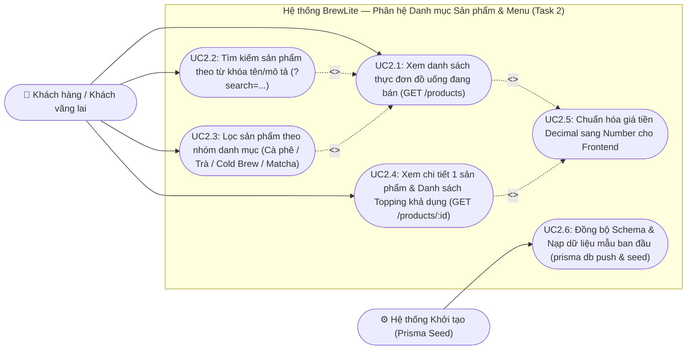
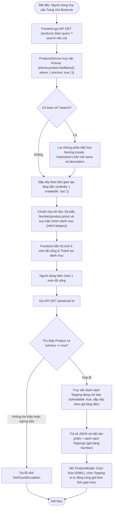
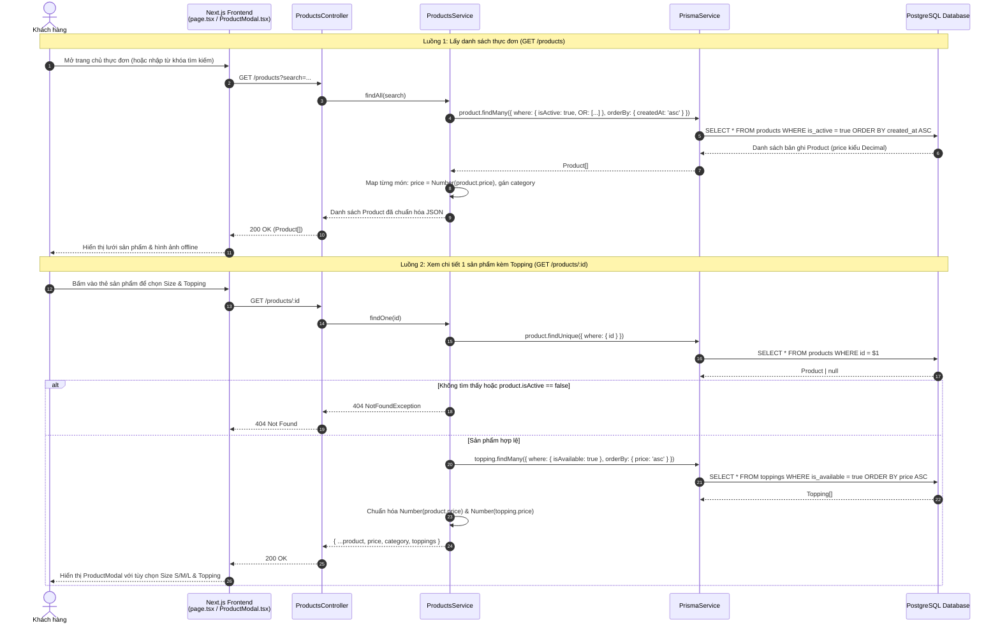
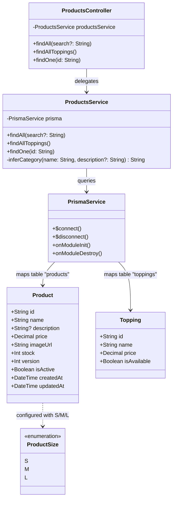
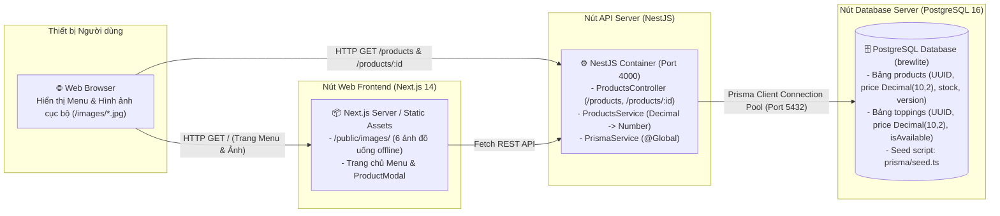

# TASK 2: Khởi tạo Prisma PostgreSQL, Seed Dữ liệu & API Menu Sản phẩm (`GET /products`)

**Người thực hiện:** Nguyễn Hữu Chí Công (Thành viên 4 — Phụ trách Backend Task 2)  
**Phạm vi:** Thiết kế `schema.prisma` kết nối PostgreSQL, xây dựng kịch bản nạp dữ liệu mẫu `prisma/seed.ts` (6 món đồ uống, 15 loại topping, 3 tài khoản RBAC, mã giảm giá), và triển khai các API `GET /products`, `GET /products/toppings`, `GET /products/:id`.

---

## 1. Bộ 5 Sơ đồ UML (Use Case, Activity, Sequence, Class, Deployment)

### 1.1. Use Case Diagram — Xem danh sách sản phẩm, Tìm kiếm & Xem chi tiết món kèm Topping

---

### 1.2. Activity Diagram — Luồng truy vấn Menu sản phẩm, lọc danh mục và xem chi tiết món

---

### 1.3. Sequence Diagram — Luồng gọi API lấy danh sách Menu (`GET /products`) và Chi tiết sản phẩm (`GET /products/:id`)

---

### 1.4. Class Diagram — Lớp `Product`, `Topping`, `ProductSize`, `PrismaService` và `ProductsService`

---

### 1.5. Deployment Diagram — Cấu trúc lưu trữ dữ liệu sản phẩm trong PostgreSQL, Prisma ORM & Next.js/NestJS

---

## 2. Đặc tả Kỹ thuật SRS — Khởi tạo Prisma, Seed Data & API Sản phẩm

### 2.1. Thiết kế Cơ sở dữ liệu (`backend/prisma/schema.prisma`)
- **Bảng `products` (`model Product`):**
  - `id` (`String @id @default(uuid())`): Khóa chính UUID chống đoán nhận dạng tuần tự.
  - `name` (`String`), `description` (`String?`), `imageUrl` (`String`).
  - `price` (`Decimal @db.Decimal(10, 2)`): Lưu trữ chính xác đơn giá tiền tệ, tránh sai số dấu phẩy động.
  - `stock` (`Int @default(0)`) & `version` (`Int @default(0)`): Hỗ trợ kiểm soát tồn kho và khóa lạc quan (*Optimistic Locking*).
  - `isActive` (`Boolean @default(true)`): Cho phép ẩn món tạm ngưng phục vụ mà không làm mất lịch sử đơn hàng cũ (`OrderItem`).
- **Bảng `toppings` (`model Topping`):**
  - `id` (`UUID`), `name` (`String`), `price` (`Decimal(10,2)`), `isAvailable` (`Boolean @default(true)`).

### 2.2. Kịch bản Nạp dữ liệu mẫu (`backend/prisma/seed.ts`)
- Sử dụng cơ chế `upsert` theo UUID cố định để có thể chạy lại nhiều lần (*idempotent seeding*) mà không gây trùng lặp dữ liệu:
  1. **6 đồ uống chuẩn:** *Cà phê sữa đá* (29.000đ), *Americano* (35.000đ), *Cappuccino* (45.000đ), *Trà đào cam sả* (42.000đ), *Cold Brew* (45.000đ), *Matcha Latte* (49.000đ).
  2. **15 loại topping** phân theo nhóm Cà phê, Trà trái cây và Matcha (giá từ 5.000đ – 10.000đ).
  3. **3 tài khoản kiểm thử RBAC** (`customer@brewlite.com`, `barista@brewlite.com`, `admin@brewlite.com` với mật khẩu `123456` đã băm bằng `bcrypt`).
  4. **2 mã khuyến mãi mẫu** (`CHAOBANMOI` giảm 10%, `GIAM15K` giảm 15.000đ) và **3 đơn hàng lịch sử mẫu** (`#BL-1042`, `#BL-1038`, `#BL-1025`).

### 2.3. Đặc tả Endpoint API Sản phẩm
| Phương thức | Endpoint | Tham số | Phản hồi thành công | Xử lý ngoại lệ |
| :-: | :--- | :--- | :--- | :--- |
| `GET` | `/products` (hoặc `/api/products`) | `?search=<keyword>` (tùy chọn) | `200 OK`: Mảng JSON các sản phẩm có `isActive = true`, `price` kiểu `number`, kèm trường `category`. | Trả mảng rỗng `[]` nếu không có món khớp từ khóa. |
| `GET` | `/products/toppings` | Không có | `200 OK`: Mảng JSON các topping có `isAvailable = true`, sắp xếp theo giá tăng dần. | — |
| `GET` | `/products/:id` | `:id` (UUID sản phẩm) | `200 OK`: Chi tiết sản phẩm kèm mảng `toppings` khả dụng. | `404 Not Found` nếu `id` không tồn tại hoặc `isActive = false`. |
