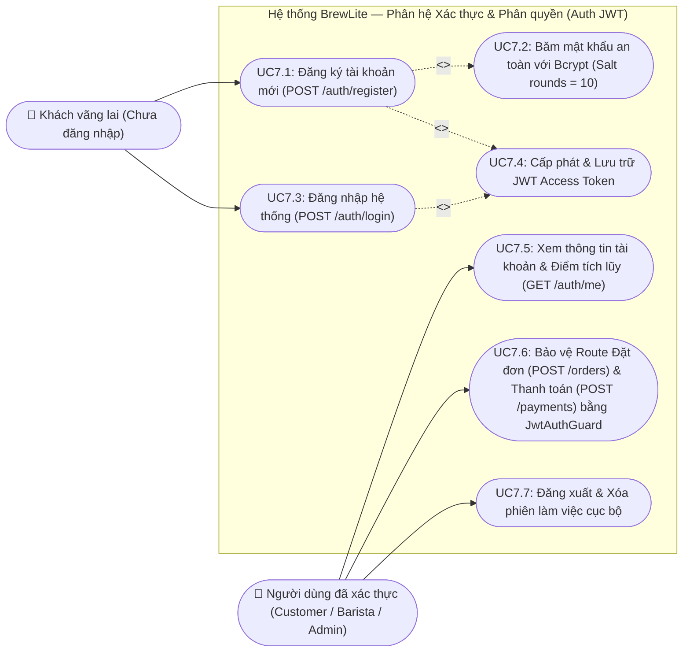
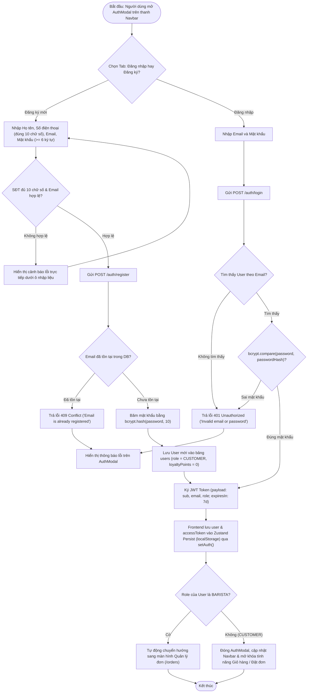
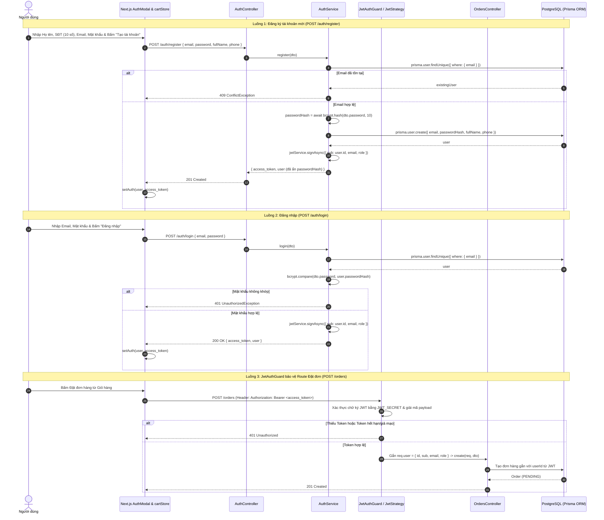
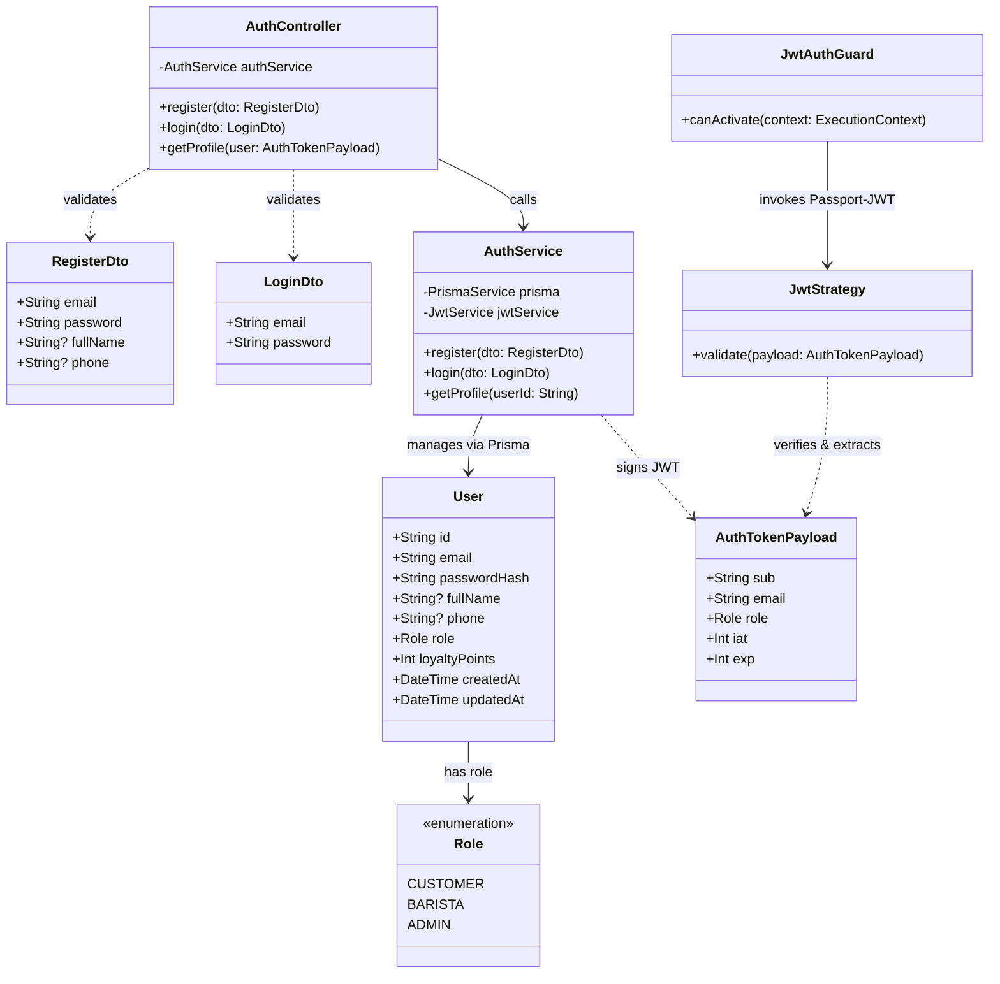
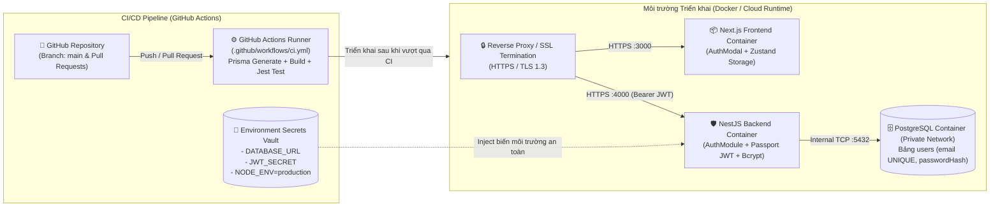

# TASK 7 (VÀ THÀNH VIÊN 5): Màn hình & Luồng "Đăng nhập & Đăng ký (JWT)"

**Người thực hiện:** Nguyễn Hữu Chí Công (Thành viên 4 — Phụ trách Backend Task 7 & Form Đăng nhập/Đăng ký Frontend)  
**Phạm vi:** API Đăng ký (`POST /auth/register`), Đăng nhập (`POST /auth/login`), Hồ sơ cá nhân (`GET /auth/me`), băm mật khẩu một chiều bằng `bcrypt`, cấp phát và xác thực `JWT Token`, `JwtAuthGuard` bảo vệ các route đặt đơn (`POST /orders`) & thanh toán (`POST /payments`), và giao diện `AuthModal.tsx`.

---

## 1. Bộ 5 Sơ đồ UML (Use Case, Activity, Sequence, Class, Deployment)

### 1.1. Use Case Diagram — Đăng ký, Đăng nhập & Quản lý tài khoản

---

### 1.2. Activity Diagram — Luồng nhập thông tin tài khoản, xác thực mật khẩu & lưu JWT Token

---

### 1.3. Sequence Diagram — Luồng gọi API xác thực (`POST /auth/register`, `POST /auth/login`) và Guard bảo vệ `POST /orders`

---

### 1.4. Class Diagram — Lớp `User`, `Role`, `AuthTokenPayload`, `AuthService`, `JwtStrategy` và `JwtAuthGuard`

---

### 1.5. Deployment Diagram — Nút CI/CD Pipeline, Cấu hình SSL/HTTPS và Lưu trữ Environment Secrets / JWT Keys

---

## 2. Đặc tả Yêu cầu Phi chức năng (Non-Functional Requirements — Bảo mật & Xác thực)

### 2.1. Mã hóa mật khẩu một chiều với `bcrypt` (NFR-SEC-01)
- **Yêu cầu:** Hệ thống tuyệt đối không lưu mật khẩu dạng văn bản thuần (plaintext) trong cơ sở dữ liệu hoặc tập tin log.
- **Thiết kế kỹ thuật:**
  - Sử dụng thuật toán `bcrypt` (`bcrypt.hash(dto.password, 10)`) với hệ số chi phí **Salt Rounds = 10** trước khi lưu vào cột `passwordHash` của bảng `users`.
  - Khi đăng nhập, sử dụng hàm so sánh chống tấn công thời gian `bcrypt.compare(dto.password, user.passwordHash)`.
  - Mọi phản hồi JSON từ `POST /auth/register`, `POST /auth/login` và `GET /auth/me` đều loại bỏ hoàn toàn trường `passwordHash`.

### 2.2. Xác thực phi trạng thái bằng JSON Web Token — JWT (NFR-SEC-02)
- **Yêu cầu:** Đảm bảo cơ chế xác thực không trạng thái (stateless), an toàn và hỗ trợ phân quyền theo vai trò (`CUSTOMER`, `BARISTA`, `ADMIN`).
- **Thiết kế kỹ thuật:**
  - Token được ký bằng thuật toán `HS256` thông qua `@nestjs/jwt` với khóa bí mật nạp từ biến môi trường `JWT_SECRET`, thời hạn hiệu lực `7d`.
  - Payload chuẩn của JWT gồm: `{ sub: user.id, email: user.email, role: user.role }`.
  - `JwtAuthGuard` (kế thừa `AuthGuard('jwt')`) được gắn trực tiếp lên các route nhạy cảm:
    - `GET /auth/me` (Xem thông tin tài khoản hiện tại).
    - `POST /orders` (Khởi tạo đơn hàng — chặn khách chưa đăng nhập đặt đơn).
    - `POST /payments` & `GET /payments/order/:orderId` (Thanh toán và tra cứu giao dịch).

### 2.3. Kiểm tra dữ liệu đầu vào ở cả hai phía (NFR-VAL-03)
- **Backend Validation (`class-validator`):**
  - `RegisterDto` & `LoginDto` kiểm tra `@IsEmail()`, `@MinLength(6)` cho mật khẩu; chuẩn hóa `email.trim().toLowerCase()` trước khi truy vấn DB.
- **Frontend Validation (`AuthModal.tsx`):**
  - Kiểm tra định dạng số điện thoại trực tiếp theo thời gian thực (`handlePhoneKeyDown`, `handlePhoneChange`): chặn nhập ký tự chữ, giới hạn đúng 10 chữ số và hiển thị thông báo tiếng Việt rõ ràng.
