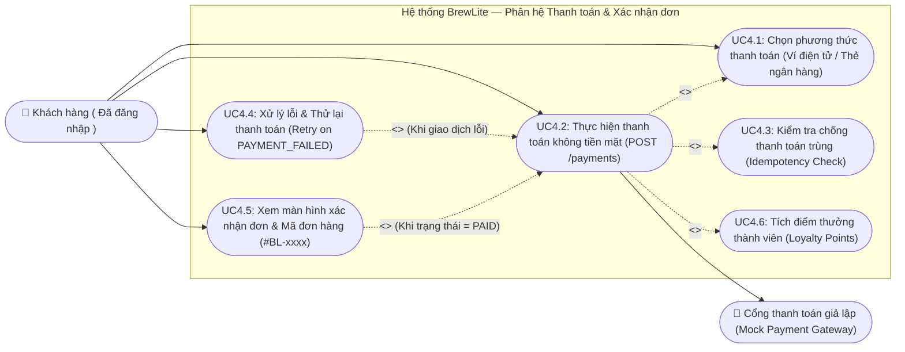
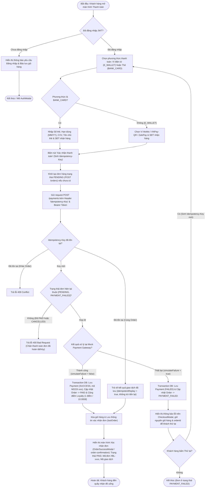
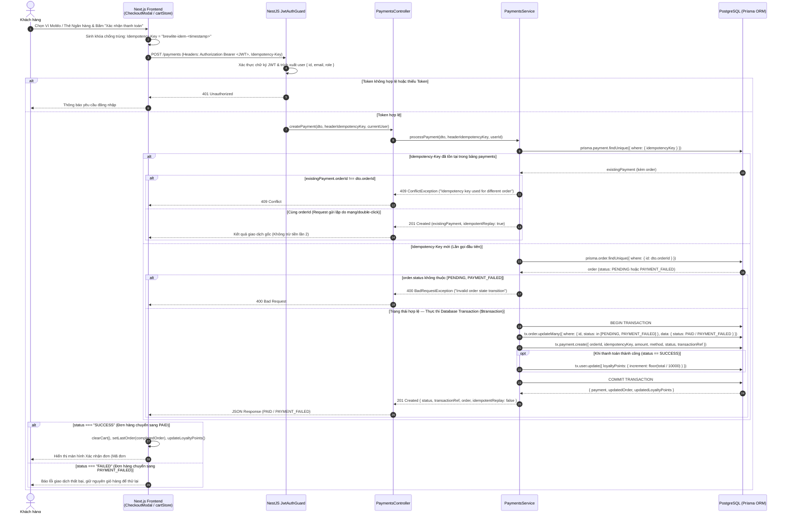
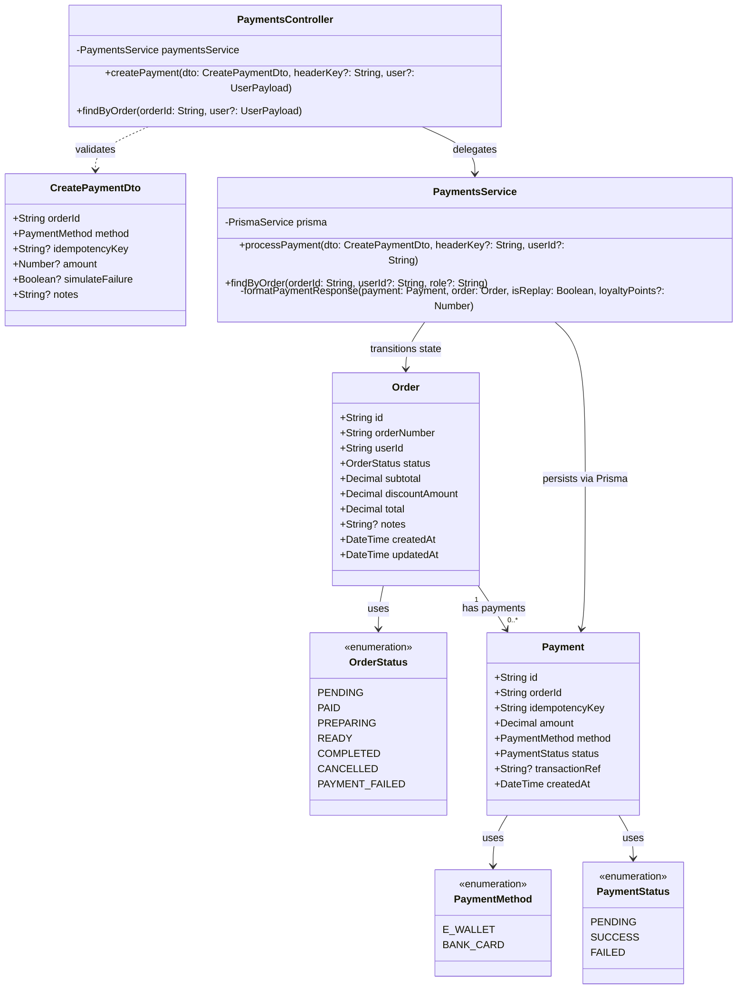
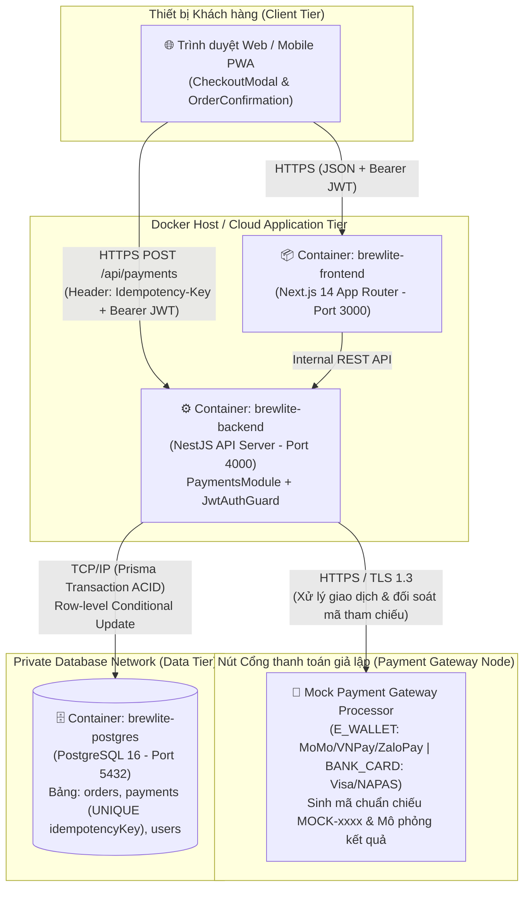

# THÀNH VIÊN 4: Màn hình & Luồng "Thanh toán & Xác nhận đơn" (Task 8)

**Người thực hiện:** Nguyễn Hữu Chí Công (Thành viên 4)  
**Phạm vi:** Cổng thanh toán giả lập không tiền mặt (`POST /payments`), cơ chế chống trừ tiền trùng lặp (`Idempotency-Key`), chuyển trạng thái đơn hàng (`PAID` / `PAYMENT_FAILED`), tích điểm thành viên (`loyaltyPoints`) và màn hình xác nhận đơn hàng.

---

## 1. Bộ 5 Sơ đồ UML (Use Case, Activity, Sequence, Class, Deployment)

### 1.1. Use Case Diagram — Thanh toán không tiền mặt & Xem màn hình xác nhận

---

### 1.2. Activity Diagram — Luồng chọn phương thức (Ví/Thẻ), xác nhận thanh toán & hiển thị trạng thái đơn (`PAID` / `PAYMENT_FAILED`)

---

### 1.3. Sequence Diagram — Luồng gọi API thanh toán Idempotent (`POST /payments`)

---

### 1.4. Class Diagram — Lớp `Payment`, `PaymentMethod`, `PaymentStatus`, `OrderStatus` và các lớp liên quan

---

### 1.5. Deployment Diagram — Nút tích hợp Cổng thanh toán giả lập (Mock Payment Gateway) qua HTTPS

---

## 2. Đặc tả Use-Case Trọng tâm: Đặt & Thanh toán Đơn hàng

### 2.1. Thông tin chung
- **Mã Use-case:** `UC-04`
- **Tên Use-case:** Đặt và Thanh toán đơn hàng không tiền mặt (*Order & Cashless Payment*)
- **Tác nhân chính (Primary Actor):** Khách hàng đã đăng nhập (`CUSTOMER`).
- **Tác nhân phụ (Secondary Actor):** Cổng thanh toán giả lập (`Mock Payment Gateway`).
- **Mô tả ngắn gọn:** Khách hàng xác nhận giỏ hàng, chọn phương thức thanh toán không tiền mặt (Ví điện tử `E_WALLET` hoặc Thẻ ngân hàng `BANK_CARD`), thực hiện thanh toán an toàn với cơ chế chống trừ tiền trùng lặp (`Idempotency-Key`) và nhận biên lai xác nhận đơn hàng kèm mã đơn (`#BL-xxxx`).

### 2.2. Tiền điều kiện (Pre-conditions)
1. Khách hàng đã đăng nhập thành công và có `access_token` (JWT) hợp lệ.
2. Giỏ hàng có ít nhất 01 sản phẩm đang hoạt động (`isActive = true`) và còn tồn kho (`stock > 0`), hoặc đơn hàng đang ở trạng thái `PENDING` / `PAYMENT_FAILED` (chờ thanh toán lại).

### 2.3. Hậu điều kiện (Post-conditions)
- **Khi thành công:**
  1. Một bản ghi `Payment` mới được lưu với `status = SUCCESS`, `transactionRef = "MOCK-..."` và khóa `idempotencyKey` duy nhất (`@unique`).
  2. Trạng thái đơn hàng (`Order.status`) chuyển nguyên tử (atomic) sang `PAID`.
  3. Điểm thưởng của khách hàng (`User.loyaltyPoints`) được cộng thêm $\lfloor \text{total} / 10.000 \rfloor$ điểm.
  4. Giỏ hàng trên Frontend được làm trống và hiển thị màn hình xác nhận đơn hàng cùng mã đơn `#BL-xxxx`.
- **Khi thất bại:**
  1. Bản ghi `Payment` được ghi nhận với `status = FAILED`, `transactionRef = null`.
  2. Trạng thái đơn hàng chuyển sang `PAYMENT_FAILED`.
  3. Giỏ hàng và mã `orderId` được bảo lưu nguyên vẹn trên giao diện để khách hàng có thể bấm **"Thử lại"** với `Idempotency-Key` mới.

### 2.4. Luồng sự kiện chính (Basic Flow — Happy Path)
1. Tại màn hình Giỏ hàng hoặc Chi tiết món, Khách hàng bấm **"Thanh toán"** để mở `CheckoutModal`.
2. Hệ thống hiển thị danh sách món, tổng tiền tạm tính, hình thức phục vụ (*Uống tại quán* / *Mang đi*), ô nhập Số điện thoại nhận hàng và 2 nhóm phương thức thanh toán: **Ví điện tử (`E_WALLET`)** và **Thẻ thanh toán (`BANK_CARD`)**.
3. Khách hàng chọn phương thức thanh toán mong muốn và bấm **"Xác nhận thanh toán"**.
4. Frontend gọi `POST /orders` (kèm `Authorization: Bearer <token>`) để khởi tạo đơn hàng ở trạng thái `PENDING` (nếu đơn chưa được tạo).
5. Frontend sinh khóa `Idempotency-Key` duy nhất và gửi yêu cầu `POST /payments` kèm thông tin `orderId`, `method`, `amount`.
6. Backend (`PaymentsService`) kiểm tra tính hợp lệ của `Idempotency-Key`, xác minh quyền sở hữu đơn hàng và kiểm tra trạng thái đơn nằm trong `[PENDING, PAYMENT_FAILED]`.
7. Trong một giao dịch cơ sở dữ liệu (`prisma.$transaction`), Backend cập nhật trạng thái đơn sang `PAID`, tạo bản ghi `Payment` (`SUCCESS`) và cộng điểm `loyaltyPoints` cho người dùng.
8. Frontend nhận phản hồi `201 Created`, xóa giỏ hàng và mở màn hình **Xác nhận đơn hàng** (`OrderSuccessModal` / `/order-confirmation`) hiển thị mã đơn hàng (`#BL-xxxx`), mã giao dịch (`MOCK-...`) và trạng thái `PAID`.

### 2.5. Luồng rẽ nhánh & Ngoại lệ (Alternative & Exception Flows)
- **E1 — Người dùng bấm nút Thanh toán liên tiếp nhiều lần hoặc mạng gửi lặp request (Idempotent Replay):**
  - Tại bước 6, `PaymentsService` phát hiện `idempotencyKey` đã tồn tại trong bảng `payments` và trùng `orderId`.
  - Hệ thống **không thực hiện trừ tiền lần 2**, không cộng điểm thưởng lần 2, mà trả về ngay bản ghi giao dịch ban đầu kèm cờ `idempotentReplay: true`.
- **E2 — Cổng thanh toán từ chối giao dịch (`simulateFailure = true`):**
  - Tại bước 7, cổng thanh toán trả về kết quả lỗi.
  - Hệ thống cập nhật `Order.status = PAYMENT_FAILED`, lưu `Payment.status = FAILED` và trả về thông báo lỗi.
  - Frontend hiển thị cảnh báo lỗi trên `CheckoutModal`, giữ nguyên giỏ hàng và `pendingOrderId` để khách hàng chọn lại phương thức khác và thanh toán lại.
- **E3 — Đơn hàng đã thanh toán (`PAID`) hoặc đã hủy (`CANCELLED`):**
  - Tại bước 6, nếu đơn hàng không ở trạng thái `PENDING` hoặc `PAYMENT_FAILED`, hệ thống chặn chuyển trạng thái và trả về lỗi `400 Bad Request ("Invalid order state transition")`.
